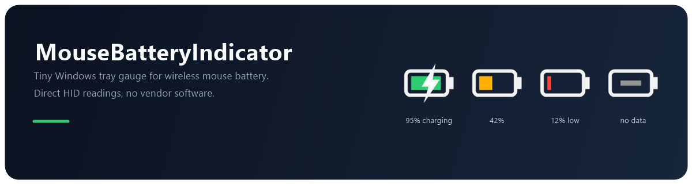

# MouseBatteryIndicator



A ~40 KB Windows tray app that shows the battery level of a **Redragon M916-ULT** wireless mouse — no Redragon software needed.

It talks to the mouse's vendor HID interface directly, so it works in the background with almost no CPU or memory use. Left-click the tray icon for the current level; the percentage refreshes every 30 s wirelessly or every 5 s while charging.

Open [`preview/gallery.html`](preview/gallery.html) in a browser to see every icon state side by side.

---

## What you get

- A battery-shaped icon in the notification area, styled like the Windows power icon:
  - **green** above 50%, **amber** 21–50%, **red** 20% and below
  - a white **bolt** while charging on the cable (below 100%)
  - **grey** when the mouse is off/asleep or the receiver is unplugged
  - on a light taskbar it automatically switches to a dark outline so it stays visible
- Optional **digits style** showing the percentage as a number (blue while charging).
- Tooltip shows level, mode and cell voltage, e.g. `M916-ULT 95% charging - 4.10 V`.
- Left-click → balloon with battery, status and cell voltage.
- One-time balloon when the battery drops to **15%** and when it reaches **100%** while charging.
- Right-click menu: refresh, icon style, start with Windows, copy diagnostics, open log folder, exit.
- Starts with Windows by default.

## Install

```powershell
cd MouseBattery
.\build.ps1      # only needed if you changed the source
.\install.ps1
```

`install.ps1` copies the exe to `%LOCALAPPDATA%\MouseBattery\MouseBattery.exe`, registers it under
`HKCU\Software\Microsoft\Windows\CurrentVersion\Run` and starts it.

The icon often lands in the hidden-icon overflow (`^`) the first time. Drag it onto the taskbar, or use
**Settings → Personalization → Taskbar → Other system tray icons** to keep it visible.

> The executable and install folder keep the short internal name `MouseBattery`; only the project/repo
> name is `MouseBatteryIndicator`.

To install without autostart:

```powershell
.\install.ps1 -NoAutostart
```

## Use

| Action | Result |
| --- | --- |
| Hover the icon | Tooltip with percentage, mode, voltage |
| Left-click | Refresh now + detail balloon |
| Right-click | Menu |

Menu items:

- **Refresh now** — read immediately instead of waiting for the next poll.
- **Icon style → Battery icon / Percentage digits** — picks the style; the choice is remembered. Selecting the style that's already active forces the tray image to redraw (useful if Windows ever leaves a stale icon).
- **Start with Windows** — adds/removes the `Run` entry.
- **Copy diagnostics** — copies the HID report and device list, useful when reporting a problem.
- **Open log folder** — opens `%LOCALAPPDATA%\MouseBattery`.
- **Exit** — quits; autostart still applies at next sign-in.

Settings live in `HKCU\Software\MouseBattery` (`Style = battery|digits`).
The log is `%LOCALAPPDATA%\MouseBattery\app.log` (rotated at 512 KB).

## Uninstall

```powershell
.\uninstall.ps1
```

Stops the app, removes the autostart entry, the settings key and `%LOCALAPPDATA%\MouseBattery`.

## Supported hardware

**It is not universal.** The app speaks one specific vendor protocol (Compx/Nordic 52840, VID `0x3554`),
so it works with that family of mice — not every mouse.

| | |
| --- | --- |
| Mouse | Redragon M916-ULT (3-mode) — tested |
| USB VID | `0x3554` (Compx) |
| PIDs | `0xF54D` wired/charging, `0xF54F` 2.4 GHz receiver (preferred in that order) |
| HID collection | usage page `0xFF02`, usage `0x0002`, 17-byte input and output reports |
| Likely compatible | other Redragon/Compx Nordic 52840 mice, e.g. the M991 family (reported, not tested here) |

Other brands (Logitech, Razer, SteelSeries, …) use their own vendor protocols and will **not** work.
Neither will generic 2.4 GHz mice, wired-only mice, or Bluetooth-only mice — the app does not implement
the standard Bluetooth GATT battery service (`0x180F`).

The app scans every HID device with VID `3554` and picks the first 17-byte vendor collection. To check
an unfamiliar mouse, run `.\dist\MouseBattery.exe --probe`: if it prints a percentage, the protocol is
compatible.

### Bluetooth mode is not supported

The battery command only exists on the USB cable and 2.4 GHz dongle interfaces. In Bluetooth mode the
mouse exposes a standard BLE HID device and this vendor protocol isn't available; the icon will show
grey. Use the dongle or the cable if you want a reading.

## Protocol

Request (17 bytes, report ID `0x08`):

```
08 04 00 00 00 00 00 00 00 00 00 00 00 00 00 00 49
```

The bytes sum to `0x55` (mod 256); byte 16 is the checksum `0x49`. Reply, same length:

```
08 04 00 00 00 02 5F 01 10 05 00 00 00 00 00 00 D2
              ^^ ^^ ^^^^^
              |  |  +-- bytes 8-9: cell voltage, big-endian (0x1005 = 4101 mV)
              |  +----- byte 7: 1 = wired/charging, 0 = wireless
              +-------- byte 6: battery percent (0x5F = 95)
```

Anything else (no reply, short read) is treated as "unknown". A reply of `00` percent with no voltage
is not shown as 0%; the icon goes grey instead.

Protocol reference: [Fan4Metal/mouse_tray → `nordic52.py`](https://github.com/Fan4Metal/mouse_tray).

## Build from source

No .NET SDK required — it compiles with the C# compiler that ships with Windows
(`%WINDIR%\Microsoft.NET\Framework64\v4.0.30319\csc.exe`), targeting .NET Framework 4.x.

```powershell
.\build.ps1
```

This compiles `Hid.cs`, `IconFactory.cs`, `Settings.cs`, `TrayApp.cs`, `Program.cs` into
`dist\MouseBattery.exe`, generates `assets\MouseBattery.ico`, rebuilds with the icon and finally runs a
battery probe so you can see whether the mouse answers.

Source layout:

| File | Contents |
| --- | --- |
| `Hid.cs` | HID enumeration, overlapped read/write, `HidReader.Read()`, diagnostics |
| `IconFactory.cs` | Battery/digit icon rendering, multi-size ICO, PNG previews |
| `Settings.cs` | Registry settings, startup entry, logging, taskbar theme detection |
| `TrayApp.cs` | Tray icon, polling, notifications, context menu |
| `Program.cs` | Entry point, single-instance mutex, `--probe`, `--preview`, `--make-icon` |

`research\` contains the standalone probe programs used to reverse-engineer the protocol; they are not
part of the app build.

## Troubleshooting

**Icon is grey / "not connected"**
Plug the 2.4 GHz receiver or the USB cable into the same machine and make sure the mouse is switched on
and paired to that receiver. Run `.\dist\MouseBattery.exe --probe` in a terminal for a device dump.

**Icon is grey but the receiver is listed**
The mouse is asleep. Move it and it will answer on the next poll (the app also refreshes immediately on
device-change events and when you left-click the icon).

**Icon shows in the overflow `^`**
Drag it onto the taskbar, or pin it via Taskbar settings → Other system tray icons.

**Two instances?**
The app is single-instance; launching it again just exits. Use the tray menu → Exit to stop it before
reinstalling.

**Regenerate icon previews**

```powershell
.\dist\MouseBattery.exe --preview .\preview
```

writes fresh PNGs into `preview\`; open `preview\gallery.html` in a browser to compare them.
